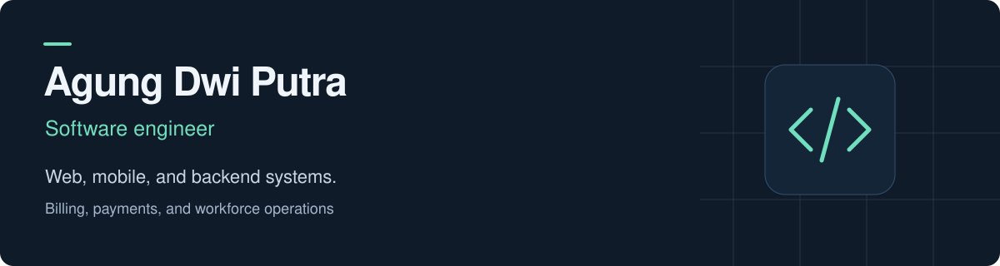

  

  <a href="https://agung-dp.net">Portfolio</a> &nbsp;·&nbsp;
  <a href="https://www.linkedin.com/in/agung-dp/">LinkedIn</a> &nbsp;·&nbsp;
  <a href="mailto:agungdwiputra150@gmail.com">Email</a>

I'm Agung, a full-stack software engineer based in Jakarta. I have **6+ years of experience** building web, mobile, and backend applications, with a focus on billing, payments, and workforce operations.

At **Luce**, I work across data models, APIs, interfaces, and background processing, through to testing and production support. I also write technical designs, review code, and work with product and operations teams to turn business requirements into working software.

### Production work

- **[Subscription billing](https://agung-dp.net/projects/luce-plus-subscription)** — Billing and membership workflows connecting payment processing, customer accounts, and administration interfaces.
- **[HR and workforce operations](https://agung-dp.net/projects/luce-hr-platform)** — Employee records, contracts, leave, payroll, and role management across Rails services and React interfaces.
- **[Invoice follow-up](https://agung-dp.net/projects/invoice-follow-up-automation)** — Background workflows for invoice status, customer reminders, validation, and error reporting.

These links describe my contributions to company projects; the source code is not hosted in my public repositories.

### Selected public projects

| Project | Focus |
| :--- | :--- |
| **[Lead Qualification API](https://github.com/agungdp150/lead-qualification-api)** | Ruby on Rails API using AI to score leads and route prospects to sales or follow-up workflows. |
| **[React Tiny Image Carousel](https://github.com/agungdp150/react-tiny-image-carousel)** | Published React package with TypeScript types, keyboard navigation, touch swipe, and responsive CSS. |
| **[Portfolio](https://github.com/agungdp150/agung-portfolio)** | The source for my personal site. Visit [agung-dp.net](https://agung-dp.net) for project case studies and my résumé. |

### Tools I work with

**Backend & data** &nbsp; Ruby on Rails · GraphQL · PostgreSQL · Sidekiq · SQL  
**Web & mobile** &nbsp; React · React Native · TypeScript · JavaScript  
**Quality & delivery** &nbsp; RSpec · Cypress · Sentry · Git · Storybook

---

Based in **Jakarta, Indonesia · UTC+7**. Reach me at [agungdwiputra150@gmail.com](mailto:agungdwiputra150@gmail.com).
